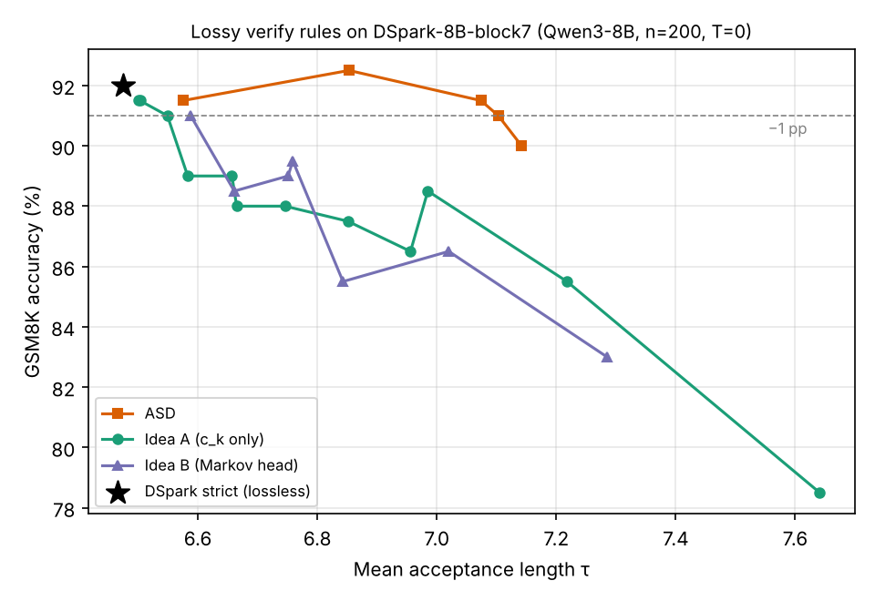

# Diffusion-Based Speculative Decoding for Efficient LLM Inference

Speculative decoding with an **autoregressive target** (Qwen3-8B) and a **block-diffusion drafter**
(DFlash / DSpark), studied with Prof. Bo Yuan (Rutgers). Everything here is training-free: the released
drafter weights are used unchanged, and only quantization, verify rules, or scheduling are modified.

| Sub-project | Question | Folder |
|---|---|---|
| DSpark verify rules | Can DSpark's own heads (confidence head, Markov head) replace ASD's regret signal in a lossy (approximate) verify rule? | [`dspark-verify-rules/`](dspark-verify-rules/) |
| DFlash drafter quantization | How sensitive is the 5-layer DFlash drafter to weight-only quantization, and which layer matters most? | [`dflash-drafter-quantization/`](dflash-drafter-quantization/) |

## Background

- **DFlash** (z-lab): a 5-layer block-diffusion drafter that proposes a whole block of tokens in one forward,
  conditioned on target hidden states.
- **DSpark** (DeepSeek): DFlash-style backbone plus a Markov head (semi-autoregressive correction inside the
  block) and a confidence head used for verify scheduling.
- **ASD** (Approximate Speculative Decoding, arXiv 2608.03447): accepts some target-mismatched draft tokens
  under a per-request regret budget, trading a little accuracy for longer acceptance length τ.

Before the experiments I reproduced DFlash with the official repository (transformers backend, Qwen3-8B +
`z-lab/Qwen3-8B-DFlash-b16`, GSM8K, 128 samples, greedy, reasoning off): τ = 6.38 vs. 6.54 reported, 4.76×
speedup vs. 5.15× reported (the paper used an H200; I used a rented RTX-class GPU).

## Headline results

**Verify rules (GSM8K, n = 200, Qwen3-8B + DSpark-8B-block7, T = 0, RTX 5090).** Neither of my rules beats
ASD: within a 1-point accuracy drop, ASD reaches τ ≈ 7.10 while the confidence-head rule reaches τ ≈ 6.55.

**Drafter quantization (DFlash, GSM8K).** The drafter is robust down to INT4 (τ 6.29 → 6.24); INT2 is the
cliff (τ 4.25), and the loss shows up as fewer long acceptance runs rather than uniform degradation.
